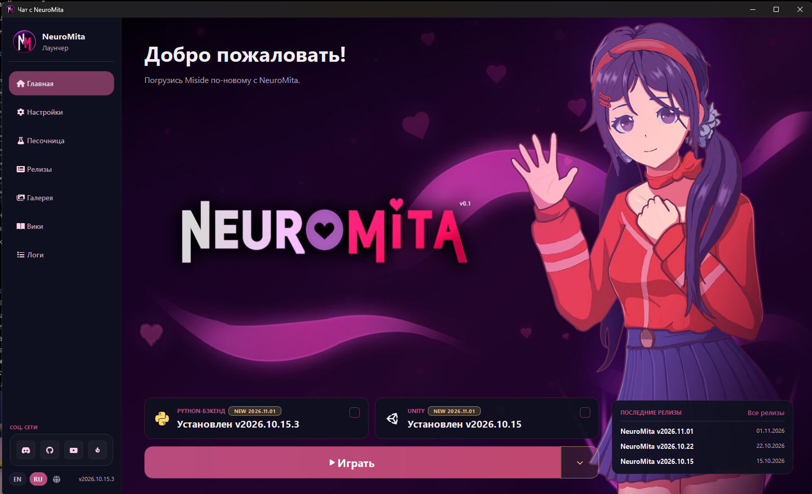
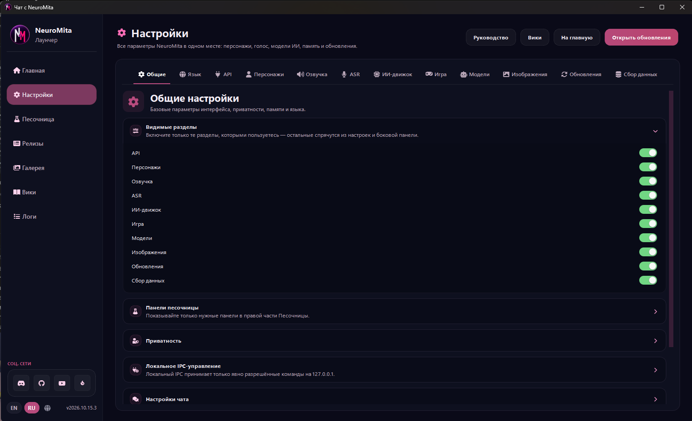
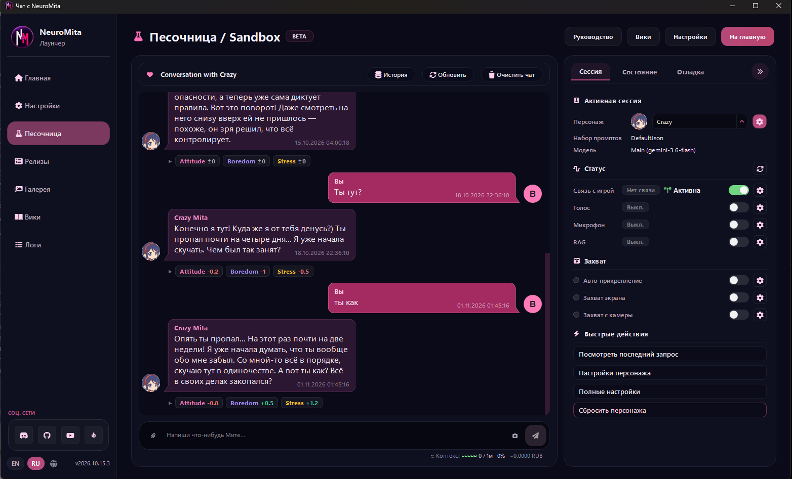
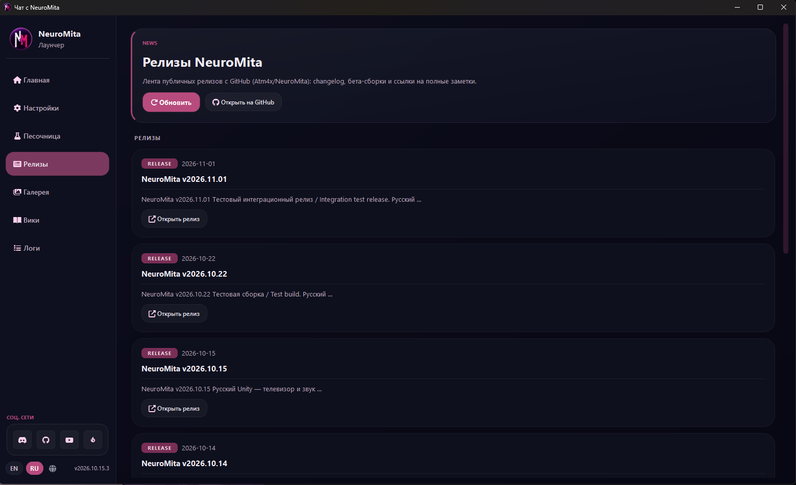
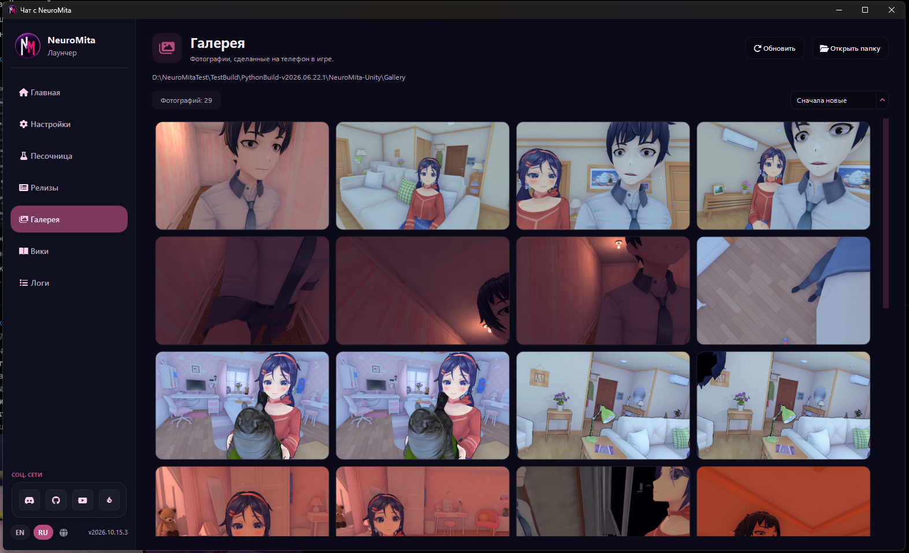
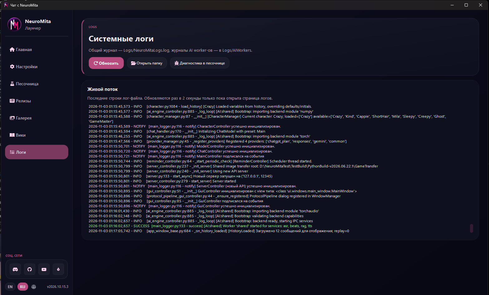
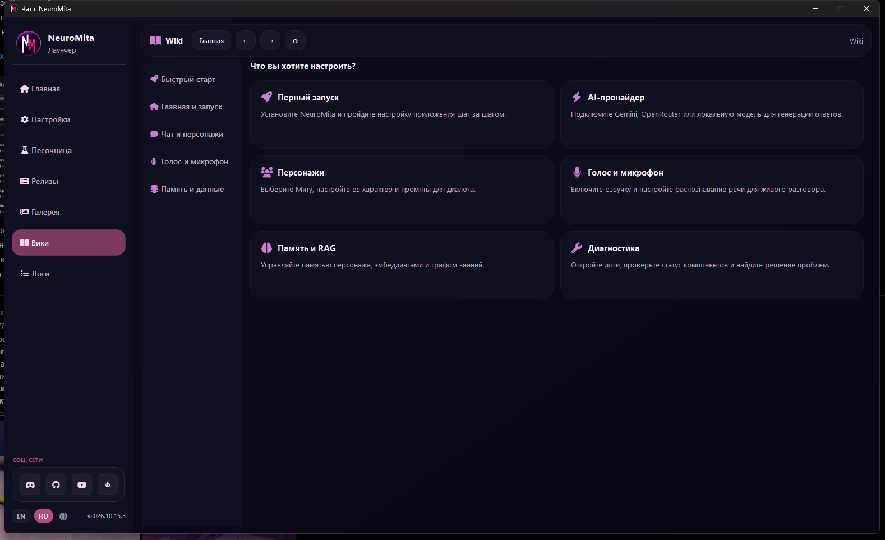

# GUI: базовые визуальные референсы

Добавлено 2026-11-03 по семи скриншотам пользователя. Оригиналы сохранены без изменения пикселей в [gui-reference](gui-reference/). Это визуальная база будущего интерфейса Rust/Slint: сейчас подготовлены зависимости и ресурсы, сами экраны ещё не реализованы.

Скриншоты определяют направление оформления и композиции, а не обязательный перенос всех функций Python. В частности, на странице настроек показано больше разделов и переключателей, чем требуется первому интерфейсу. Состав настроек выбираем по реализованным типизированным контрактам ядра.

## Общая оболочка

Тёмные сине-чёрные поверхности, светлый текст, розовые акценты, округлённые карточки с тонкой обводкой. Постоянная левая навигация: логотип и название сверху, разделы приложения посередине, социальные ссылки, язык и версия снизу. Основная рабочая область меняется при переходе между разделами.

Файлы фона, логотипов, аватаров и SVG уже перенесены в [assets](../assets/). Их назначение, исходные вызовы Python и ограничения описаны в [аудите ассетов](../docs/02-ui/gui-assets-and-reference.md); полный перечень и SHA-256 — в [manifest.json](../assets/manifest.json).

## 1. Главная / лаунчер

Иллюстрированный фон, приветствие, карточки установленных компонентов, основная кнопка запуска и краткий список релизов. Фон из исходного приложения: [bg.jpg](../assets/launcher_ui/bg.jpg); знак в боковой панели: [NM_Logo.png](../assets/launcher_ui/NM_Logo.png).

## 2. Настройки

Горизонтальные категории внутри рабочей области, заголовок и описание текущего раздела, раскрываемые группы и подписанные элементы управления. Это пример оформления кастомной страницы настроек, а не задание воспроизвести весь показанный каталог. Контракты команд и binding описаны в [presentation-and-settings](presentation-and-settings.md).

## 3. Песочница / Sandbox

Слева беседа и ввод сообщения, справа панель с вкладками сессии, состояния и диагностики. Раздельные пузырьки пользователя и персонажа, аватары, время и дополнительные сведения под ответом. Для поведения предварительного сообщения, озвучки и отмены действует [согласованный контракт доставки](request-delivery-and-cancellation.md); статический скриншот его не заменяет.

## 4. Релизы

Вводная карточка с действиями и прокручиваемая лента релизов. В карточке — тип, дата, версия, краткий текст и переход к полной записи.

## 5. Галерея

Заголовок, каталог, счётчик, сортировка и сетка превью с одинаковыми пропорциями карточек. Фотографии внутри этого скриншота служат примером наполнения. Реальная галерея — пользовательские данные; её файлы не включены в пакет ассетов приложения.

## 6. Логи

Карточка описания и действий, ниже область журнала с моноширинным текстом и цветами уровней. Интервал обновления и пути из Python на скриншоте не задают контракт будущего Rust frontend.

## 7. Wiki

Внутренняя панель навигации и истории переходов, тематическое меню слева и карточки справочных материалов справа.

## Граница текущего дополнения

Добавлены изображения, ресурсы и их описание. Python QSS, обработчики кнопок и зависимости Qt не перенесены. Frontend будет вызывать команды presenter и наблюдать предоставленные данные по [контрактам presentation](presentation-and-settings.md); визуальные референсы не меняют владение персонажами, настройки или жизненный цикл запросов.
